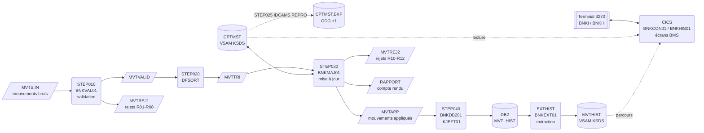
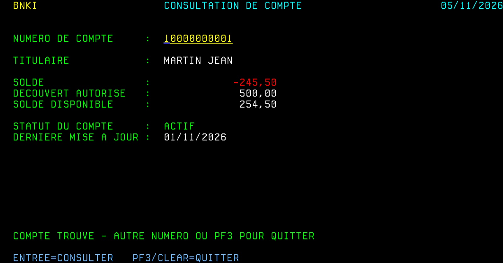
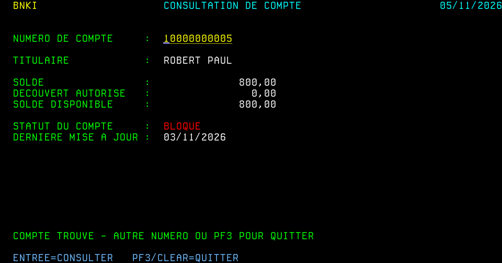
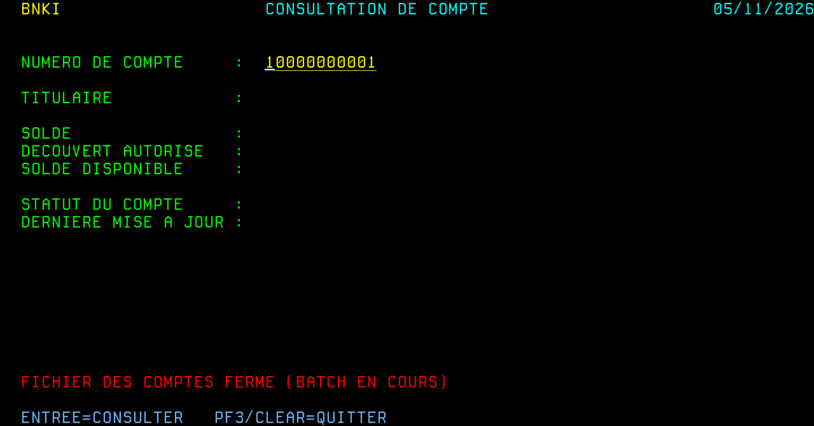
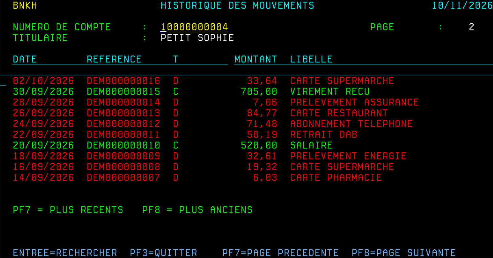

# Batch bancaire COBOL — mainframe z/OS

Application bancaire écrite pour z/OS, avec une partie batch et une partie transactionnelle : **COBOL, JCL, VSAM KSDS, DFSORT, IDCAMS, GDG, DB2 et CICS (BMS)**.

- **Batch** : la chaîne valide les mouvements du jour, les trie, met à jour le fichier maître des comptes en contrôlant le découvert autorisé, produit un compte rendu avec totaux de contrôle, puis charge l'historique dans une table DB2.
- **Transactionnel** : la transaction CICS `BNKI` permet de consulter un compte en temps réel sur un écran 3270, à partir du même fichier VSAM que celui mis à jour par le batch ; la transaction `BNKH` affiche l'historique de ses mouvements, page par page, à partir d'une extraction de la table DB2.

> ✅ **Testée de bout en bout sur un vrai mainframe** (IBM Z Xplore : z/OS 3.1, Enterprise COBOL, Db2 for z/OS, région CICS TS personnelle) — voir [Exécution sur z/OS](#exécution-sur-zos-ibm-z-xplore).
> ✅ **Testée en continu** à chaque push avec GnuCOBOL (GitHub Actions), à partir des mêmes sources.

---

## Schéma de la chaîne



## Exécution sur z/OS (IBM Z Xplore)

| Job / step | Programme | RC obtenu | Résultat |
|---|---|---|---|
| COMPBAT | Compilation batch | 04 | Avertissements du compilateur uniquement |
| DEFKSDS | IDCAMS + BNKINI01 | 00 | KSDS et GDG définis, 8 comptes chargés |
| BNKCHAIN STEP010 | BNKVAL01 | 04 | 25 lus, 16 valides, 9 rejetés |
| BNKCHAIN STEP020 | DFSORT | 00 | Mouvements triés |
| BNKCHAIN STEP025 | IDCAMS REPRO | 00 | Sauvegarde du KSDS dans la GDG |
| BNKCHAIN STEP030 | BNKMAJ01 | 04 | 11 appliqués, 5 rejetés, 7 comptes mis à jour |
| COMPDB2 | Coprocesseur SQL + BIND | 04 | Plan lié avec succès |
| LOADDB2 (1er passage) | BNKDB201 | 00 | 11 lignes insérées |
| LOADDB2 (relance) | BNKDB201 | 04 | 11 doublons ignorés, aucune ligne en double |

RC=4 sur les steps de traitement est attendu : le jeu de test contient volontairement des mouvements en erreur.

**Compte rendu de mise à jour (STEP030, sortie RAPPORT)**


**Chargement DB2, puis relance du même job : aucun doublon (SQLCODE -803 géré)**


**Contrôle dans DB2 : les totaux de la table correspondent au compte rendu** (2 899,50 de crédits et 3 975,49 de débits)


Le compte rendu obtenu sur z/OS est identique, ligne pour ligne, à celui produit par GnuCOBOL dans GitHub Actions (`tests/expected/rapport.txt`).

## Transaction CICS BNKI : consultation de compte

L'utilisateur saisit un numéro de compte sur un écran 3270 ; le programme lit le compte dans le KSDS et affiche le titulaire, le solde, le découvert autorisé, le solde disponible, le statut et la date de dernière mise à jour. Captures réalisées sur la région CICS, après exécution de la chaîne batch :

**Compte actif à découvert** (le solde négatif s'affiche en rouge ; on retrouve le solde de -245,50 calculé par le batch)



**Compte bloqué** (statut en rouge)



**Fichier fermé pendant le batch** (`CEMT SET FILE(CPTMST) CLOSED DISABLED`) : message clair au lieu d'un abend



**Tests réalisés sur la région CICS**

| Saisie | Résultat |
|---|---|
| Premier appel `BNKI` | Écran vide, curseur sur la saisie, date du jour |
| Compte existant | Informations du compte, solde négatif et compte bloqué en rouge |
| Compte inexistant | « COMPTE ... INEXISTANT » en rouge (`RESP = NOTFND`) |
| Saisie incomplète ou non numérique | « LE NUMERO DE COMPTE DOIT COMPORTER 11 CHIFFRES » |
| Touche non prévue (PF5…) | « TOUCHE NON VALIDE » |
| Fichier fermé et désactivé | « FICHIER DES COMPTES FERME (BATCH EN COURS) » (`RESP = DISABLED`) |
| PF3 ou CLEAR | Message de fin et sortie de la transaction |

**Conception**

- **Pseudo-conversationnel** : après chaque écran, le programme rend la main à CICS (`RETURN TRANSID('BNKI') COMMAREA`) et n'occupe aucune ressource pendant que l'utilisateur saisit. Le premier appel est détecté par `EIBCALEN = 0`, la touche par `EIBAID` (copybook `DFHAID`).
- **Écran BMS** assemblé deux fois : map physique chargée par CICS, map symbolique utilisée comme copybook par le programme. Couleurs dynamiques (`DSATTS=COLOR`) : solde négatif, compte bloqué et messages d'erreur en rouge.
- **Toutes les commandes sensibles testées par `RESP`** : `MAPFAIL` (rien saisi), `NOTFND` (compte inexistant), `NOTOPEN`/`DISABLED` (fichier fermé pendant le batch), autres erreurs avec le code RESP affiché.
- **Contrôle de saisie** : le numéro doit comporter 11 chiffres avant toute lecture du fichier.
- **Lecture seule** : le fichier est défini dans CICS avec `READ(YES)` uniquement ; seule la chaîne batch met à jour les comptes.
- **Même copybook `CPYCPT`** pour le batch et le transactionnel : une seule description de l'enregistrement.

**Ressources CICS (groupe `BNKGRP`)**

| Type | Nom | Rôle |
|---|---|---|
| TRANSACTION | `BNKI` | Code saisi par l'utilisateur |
| PROGRAM | `BNKCON01` | Programme COBOL |
| MAPSET | `BNKMS01` | Écran BMS |
| FILE | `CPTMST` | KSDS des comptes, lecture seule |

**Cohabitation avec le batch** : la chaîne batch ouvre le KSDS en exclusivité (`DISP=OLD`). Avant de la lancer, on ferme le fichier dans CICS, puis on le rouvre ensuite ; pendant ce temps, `BNKI` affiche « FICHIER DES COMPTES FERME (BATCH EN COURS) » au lieu d'abender.

```
CEMT SET FILE(CPTMST) CLOSED DISABLED     avant BNKCHAIN ou DEFKSDS
CEMT SET FILE(CPTMST) ENABLED             après le batch
```

## Transaction CICS BNKH : historique des mouvements avec pagination

L'utilisateur saisit un numéro de compte ; la transaction affiche le titulaire et les mouvements du compte, du plus récent au plus ancien, 10 par page (PF8 : plus anciens, PF7 : plus récents). Débits en rouge, crédits en vert.

Capture réalisée sur la région CICS, page 2 du compte `10000000004` (26 mouvements, dont 24 de démonstration) : la page reprend exactement après la dernière ligne de la page 1, sans trou ni doublon.



**Architecture : DB2 → extraction → VSAM → CICS**

La région CICS de l'environnement n'est pas connectée à DB2 (`CEMT INQUIRE DB2CONN` : `NOT FOUND`), et sa configuration est gérée par le système. Plutôt que de modifier la procédure de démarrage fournie, l'historique est mis à disposition du transactionnel par une **extraction batch**, un schéma courant en production :

- **DB2 reste la référence** : la table `MVT_HIST` est alimentée par la chaîne batch (`BNKDB201`).
- **`BNKEXT01`** (job `EXTHIST`) lit la table avec un curseur trié et écrit le KSDS `BANK.MVTHIST`. En production, ce serait un step de la chaîne, juste après le chargement DB2.
- **`BNKH`** lit ce KSDS en parcours CICS (`STARTBR`, `READNEXT`, `READPREV`, `ENDBR`).

**Conception**

- **Clé du KSDS = compte + date inversée (99999999 − AAAAMMJJ) + référence** : pour un compte, l'ordre croissant des clés donne directement les mouvements du plus récent au plus ancien, sans tri à l'exécution.
- **Pagination par clé** : la COMMAREA conserve la clé de la première et de la dernière ligne affichées. PF8 repart de la dernière avec `READNEXT`, PF7 de la première avec `READPREV`, puis le programme remet les lignes dans l'ordre d'affichage. Le premier enregistrement lu (celui de départ, déjà affiché) est ignoré. Le coût d'une page ne dépend pas de sa position dans l'historique.
- **Détection de la page suivante** : 11 lignes lues pour 10 affichées ; la 11e indique qu'il existe une page suivante, sans lecture supplémentaire.
- **Pseudo-conversationnel** : chaque parcours est ouvert et fermé (`ENDBR`) dans la même tâche.
- **`SEND MAP DATAONLY`** pour les messages seuls (première ou dernière page, touche non valide) : seule la ligne de message est transmise, la liste reste à l'écran.
- **Robustesse** : fichier fermé pendant l'extraction (« HISTORIQUE INDISPONIBLE »), clé de départ disparue après un rechargement (« REFAITES LA RECHERCHE »), fichier des comptes fermé (l'historique reste consultable).

`sql/HISTDEMO.sql` ajoute 24 mouvements de démonstration au compte `10000000004` (26 au total, soit 3 pages).

## Contenu du dépôt

| Élément | Rôle |
|---|---|
| `src/cobol/BNKINI01.cbl` | Chargement initial du KSDS des comptes |
| `src/cobol/BNKVAL01.cbl` | Validation des mouvements (8 contrôles, dont dates et années bissextiles) |
| `src/cobol/BNKMAJ01.cbl` | Mise à jour du KSDS par rupture sur le compte, contrôle du découvert, compte rendu |
| `src/cobol/BNKDB201.cbl` | Chargement de l'historique DB2 (INSERT, COMMIT périodique, gestion SQLCODE) |
| `src/cobol/BNKCON01.cbl` | Programme CICS de la transaction `BNKI` (consultation de compte) |
| `src/cobol/BNKEXT01.cbl` | Extraction de l'historique DB2 vers un KSDS pour le transactionnel |
| `src/cobol/BNKHIS01.cbl` | Programme CICS de la transaction `BNKH` (historique paginé, parcours VSAM) |
| `src/bms/BNKMS01.bms` | Écran BMS de la transaction `BNKI` |
| `src/bms/BNKMS02.bms` | Écran BMS de la transaction `BNKH` |
| `src/copybook/` | Descriptions d'enregistrements (`CPYMVT`, `CPYCPT`, `CPYREJ`, `CPYHIS`) et DCLGEN DB2 (`DCLMVTH`) |
| `jcl/ALLOC.jcl` | Allocation des bibliothèques et fichiers d'entrée (IEFBR14) |
| `jcl/DEFKSDS.jcl` | IDCAMS : définition de la GDG et du KSDS, puis chargement initial (relançable) |
| `jcl/COMPBAT.jcl` | Compilation des programmes batch (procédure IGYWCL) |
| `jcl/COMPDB2.jcl` | Compilation d'un programme batch DB2 (symbole `PROG`) avec le coprocesseur DB2, édition de liens et BIND |
| `jcl/BNKCHAIN.jcl` | La chaîne batch complète (6 steps) |
| `jcl/LOADDB2.jcl` | Relance seule du chargement DB2 après incident |
| `jcl/EXTHIST.jcl` | Extraction de l'historique DB2 vers le KSDS `MVTHIST` lu par CICS |
| `jcl/RESTORE.jcl` | Restauration du KSDS depuis la dernière sauvegarde |
| `jcl/COMPBMS.jcl` | Assemblage d'un écran BMS (symbole `MAPSET`) : map physique et map symbolique |
| `jcl/COMPCICS.jcl` | Compilation d'un programme CICS (symbole `PROG`, procédure DFHZITCL, traducteur intégré) |
| `jcl/DEFCICS.jcl` | Définitions CICS du groupe `BNKGRP` par DFHCSDUP (alternative à CEDA) |
| `sql/CRTABLE.sql` | DDL de la table `MVT_HIST` et requêtes de contrôle |
| `sql/HISTDEMO.sql` | Jeu de démonstration de la pagination (24 mouvements supplémentaires) |
| `data/` | Jeu de test : 8 comptes, 25 mouvements dont 14 cas d'erreur |
| `tests/` | Exécution locale de la chaîne, résultats attendus et vérification syntaxique des programmes CICS et DB2 |
| `docs/` | Captures de l'exécution sur z/OS |

## Règles de gestion

**Validation (BNKVAL01)** — le premier contrôle en erreur détermine le code rejet :

| Code | Contrôle |
|---|---|
| R01 | Référence du mouvement absente |
| R02 | Numéro de compte non numérique |
| R03 | Type différent de `D` (débit) ou `C` (crédit) |
| R04 | Montant non numérique |
| R05 | Montant nul |
| R06 | Date non numérique |
| R07 | Date invalide (mois, nombre de jours, 29 février hors année bissextile) |
| R08 | Date postérieure à la date de traitement |

**Mise à jour (BNKMAJ01)** :

| Code | Contrôle |
|---|---|
| R10 | Compte inexistant dans le KSDS |
| R11 | Compte bloqué |
| R12 | Débit qui ferait dépasser le découvert autorisé |

## Choix techniques

- **Traitement par rupture sur le numéro de compte** : une seule lecture directe du KSDS et un seul `REWRITE` par compte, quel que soit le nombre de mouvements. Le solde est calculé en mémoire.
- **Contrôle de séquence** : `BNKMAJ01` vérifie que le fichier est bien trié et s'arrête en RC=16 sinon, plutôt que de produire une mise à jour fausse.
- **Tri métier** : à date égale, les crédits passent avant les débits (`24,1,CH,A`). Dans le jeu de test, le compte `10000000003` reçoit un virement et un prélèvement le même jour : grâce à ce tri, le prélèvement passe au lieu d'être rejeté pour découvert.
- **Totaux de contrôle** : le compte rendu vérifie que mouvements lus = appliqués + rejetés. En cas d'écart, RC=16.
- **Codes retour normalisés** : 0 = OK, 4 = rejets ou avertissements, 12 = erreur SQL, 16 = erreur fichier. Les steps suivants sont conditionnés par `COND=` et par `IF/THEN/ENDIF`.
- **File status testé après chaque opération d'E/S**, y compris le `97` VSAM (ouverture après VERIFY implicite).
- **`BLOCK CONTAINS 0 RECORDS`** sur les fichiers séquentiels : la taille de bloc est déterminée par le système.
- **Reprise** : sauvegarde du KSDS dans une GDG avant mise à jour (`STEP025`) et JCL de restauration. Le chargement DB2 est relançable sans doublons : un `SQLCODE -803` (clé en double) signifie que le mouvement est déjà chargé, il est compté et ignoré. Le job `LOADDB2.jcl` relance ce chargement seul.
- **DB2** : COMMIT tous les 100 mouvements, diagnostic des erreurs avec `DSNTIAR`, `ROLLBACK` puis arrêt RC=12.
- **Montants** en `COMP-3` dans le fichier maître, compte rendu édité au format français (`DECIMAL-POINT IS COMMA`).

## Problèmes rencontrés sur z/OS et solutions

Le passage de GnuCOBOL au vrai mainframe a demandé plusieurs adaptations, toutes diagnostiquées à partir des messages système ou des tests :

| Symptôme | Cause | Solution |
|---|---|---|
| Création de fichier refusée par Zowe CLI : *SMS or ACS services returned an error* | Les attributs envoyés par défaut ne respectent pas les règles de stockage du site | `zowe zos-files create data-set ... --like <modèle> --record-length 80`, ou allocation par JCL (`ALLOC.jcl`) |
| `ABEND S913`, message `ICH408I ... INSUFFICIENT ACCESS AUTHORITY` | Accès RACF refusé à une bibliothèque DB2 qui n'était pas celle du site | Utilisation de la bibliothèque `SDSNLOAD` et du sous-système DB2 du site |
| `SQLCODE -551` au `CREATE TABLE` | Création de table interdite hors de la base de données de l'utilisateur | Ajout de `IN DATABASE <ID>` |
| `IEW2456E SYMBOL CEESTART UNRESOLVED` (et autres `CEE*`, `IGZ*`) à l'édition de liens | Bibliothèque Language Environment absente du `SYSLIB` | `LKED.SYSLIB` déclaré explicitement : `CEE.SCEELKED` puis `SDSNLOAD` |
| `DSN SYSTEM(&SSID)` transmis tel quel, `COMMAND BIND NOT FOUND` | Un symbole défini par `SET` n'est pas substitué dans les cartes in-stream | Ajout de `// EXPORT SYMLIST=*` |
| `DSNT235I BIND AUTHORIZATION ERROR ... PRIVILEGE = BINDADD` | Création de package interdite au compte étudiant | DBRM lié directement dans le plan (`BIND PLAN ... MEMBER(BNKDB201)`). En entreprise : `BIND PACKAGE` dans une collection, puis `BIND PLAN ... PKLIST` |
| `CEMT INQUIRE DB2CONN` : `NOT FOUND` | La région CICS n'est pas connectée à DB2, et sa procédure de démarrage appartient au système | Pas de modification de la configuration fournie : extraction batch DB2 → KSDS (`BNKEXT01`), lu par CICS en parcours VSAM |
| `BNKH` : abend `APCT` | Le mapset avait été défini sous un nom erroné (`NBKMS02`) : le bon mapset n'était pas installé (`CEMT INQUIRE PROGRAM(BNKMS02)` : `NOT FOUND`) | Définition erronée supprimée, `CEDA INSTALL MAPSET(BNKMS02)` |
| Transaction CICS : message « COMPTE ... INEXISTANT**OU PF3 POUR QUITTER** » | `STRING` n'efface pas la fin de la zone réceptrice : il restait la fin du message précédent | `MOVE SPACES` sur la zone avant chaque `STRING` |

## Déploiement sur z/OS (Zowe CLI)

Remplace `Z99999` par ton identifiant.

**1. Fichiers.** Les bibliothèques de sources sont créées sur le modèle d'une bibliothèque FB 80 existante, les fichiers de données sur le modèle d'un fichier séquentiel existant (ou avec `jcl/ALLOC.jcl`). `Z99999.LOAD` et `Z99999.DBRMLIB` doivent exister.

```bash
zowe zos-files create data-set "Z99999.BANK.COBOL" --like "Z99999.CBL"
zowe zos-files create data-set "Z99999.BANK.CPY"   --like "Z99999.CBL"
zowe zos-files create data-set "Z99999.BANK.SEED.COMPTES" --like "<FICHIER SEQUENTIEL FB>" --record-length 80
zowe zos-files create data-set "Z99999.BANK.MVTS.IN"      --like "<FICHIER SEQUENTIEL FB>" --record-length 80
```

**2. Sources et données.**

```bash
zowe zos-files upload dir-to-pds "src/cobol"    "Z99999.BANK.COBOL"
zowe zos-files upload dir-to-pds "src/copybook" "Z99999.BANK.CPY"
zowe zos-files upload file-to-data-set "data/comptes.txt"    "Z99999.BANK.SEED.COMPTES"
zowe zos-files upload file-to-data-set "data/mouvements.txt" "Z99999.BANK.MVTS.IN"
```

**3. Table DB2.** Exécuter `sql/CRTABLE.sql` (extension Db2 for z/OS de VS Code, SPUFI ou DSNTEP2), après avoir remplacé `Z99999` par ton identifiant dans la clause `IN DATABASE`.

**4. Compilation, initialisation, exécution.**

```bash
zowe zos-jobs submit local-file "jcl/COMPBAT.jcl"  --wait-for-output
zowe zos-jobs submit local-file "jcl/COMPDB2.jcl"  --wait-for-output
zowe zos-jobs submit local-file "jcl/DEFKSDS.jcl"  --wait-for-output
zowe zos-jobs submit local-file "jcl/BNKCHAIN.jcl" --wait-for-output
```

À adapter à ton site : `DB2HLQ` (préfixe de `SDSNLOAD`) et `SSID` (sous-système DB2) dans `COMPDB2.jcl`, `BNKCHAIN.jcl` et `LOADDB2.jcl`. Les valeurs fournies (`DSND10`, `DBDG`) sont celles d'IBM Z Xplore. La date de traitement est passée en carte `SYSIN` (`20261101`) aux steps 010 et 030 ; en production, elle viendrait de l'ordonnanceur.

Pour retrouver les mêmes résultats lors d'une nouvelle exécution, relancer `DEFKSDS.jcl` avant `BNKCHAIN.jcl` (sinon les mouvements s'appliquent à des soldes déjà mis à jour).

**5. Transaction CICS.** Région CICS démarrée ; écran BMS dans une bibliothèque `Z99999.BANK.BMS` (FB 80).

```bash
zowe zos-files create data-set "Z99999.BANK.BMS" --like "Z99999.CBL"
zowe zos-files upload dir-to-pds "src/bms" "Z99999.BANK.BMS"
zowe zos-jobs submit local-file "jcl/COMPBMS.jcl"  --wait-for-output
zowe zos-jobs submit local-file "jcl/COMPCICS.jcl" --wait-for-output
```

Puis, sur le terminal 3270 connecté à la région :

```
CEDA DEFINE PROGRAM(BNKCON01) GROUP(BNKGRP) LANGUAGE(COBOL)
CEDA DEFINE MAPSET(BNKMS01) GROUP(BNKGRP)
CEDA DEFINE TRANSACTION(BNKI) GROUP(BNKGRP) PROGRAM(BNKCON01)
CEDA DEFINE FILE(CPTMST) GROUP(BNKGRP) DSNAME(Z99999.BANK.CPTMST)
     READ(YES) BROWSE(NO) ADD(NO) UPDATE(NO) DELETE(NO)
CEDA INSTALL GROUP(BNKGRP)
BNKI
```

Après une recompilation : `CEMT SET PROGRAM(BNKCON01) NEWCOPY` (et `CEMT SET PROGRAM(BNKMS01) NEWCOPY` pour l'écran : une fois installé, un mapset se gère avec les commandes PROGRAM).

**6. Transaction BNKH (historique).** Extraction DB2 vers VSAM, puis transaction CICS.

```bash
zowe zos-files upload file-to-data-set "src/copybook/CPYHIS.cpy" "Z99999.BANK.CPY(CPYHIS)"
zowe zos-files upload file-to-data-set "src/cobol/BNKEXT01.cbl" "Z99999.BANK.COBOL(BNKEXT01)"
zowe zos-files upload file-to-data-set "src/cobol/BNKHIS01.cbl" "Z99999.BANK.COBOL(BNKHIS01)"
zowe zos-files upload file-to-data-set "src/bms/BNKMS02.bms"    "Z99999.BANK.BMS(BNKMS02)"
zowe zos-jobs submit local-file "jcl/COMPDB2.jcl"  --wait-for-output   # PROG=BNKEXT01
zowe zos-jobs submit local-file "jcl/EXTHIST.jcl"  --wait-for-output
zowe zos-jobs submit local-file "jcl/COMPBMS.jcl"  --wait-for-output   # MAPSET=BNKMS02
zowe zos-jobs submit local-file "jcl/COMPCICS.jcl" --wait-for-output   # PROG=BNKHIS01
```

Puis sur le terminal 3270 :

```
CEDA DEFINE PROGRAM(BNKHIS01) GROUP(BNKGRP) LANGUAGE(COBOL)
CEDA DEFINE MAPSET(BNKMS02) GROUP(BNKGRP)
CEDA DEFINE TRANSACTION(BNKH) GROUP(BNKGRP) PROGRAM(BNKHIS01)
CEDA DEFINE FILE(MVTHIST) GROUP(BNKGRP) DSNAME(Z99999.BANK.MVTHIST)
     READ(YES) BROWSE(YES) ADD(NO) UPDATE(NO) DELETE(NO)
CEDA INSTALL GROUP(BNKGRP)
BNKH
```

Pour rafraîchir l'historique après une nouvelle exécution de la chaîne : `CEMT SET FILE(MVTHIST) CLOSED DISABLED`, job `EXTHIST`, puis `CEMT SET FILE(MVTHIST) ENABLED`.

## Exécution locale (GnuCOBOL)

```bash
sudo apt-get install gnucobol     # ou : brew install gnucobol
bash tests/run_local.sh
```

Le script compile les programmes batch, convertit les données au format mainframe (enregistrements fixes `RECFM=FB`, sans fin de ligne), exécute les steps dans l'ordre du JCL et compare les sorties aux résultats attendus (`tests/expected/`). Les cartes DD sont simulées par des variables d'environnement (`DD_MVTIN`, `DD_CPTMST`…), ce qui permet d'utiliser les sources z/OS sans aucune modification. Le tri DFSORT est émulé avec `sort`. Le step DB2 n'est exécutable que sur z/OS.

`python3 tests/zos_syntax_check.py` vérifie la syntaxe COBOL des programmes CICS et DB2 (`BNKCON01`, `BNKHIS01`, `BNKDB201`, `BNKEXT01`) : les commandes `EXEC CICS` et `EXEC SQL` sont neutralisées, les copybooks CICS et la SQLCA simulés, et la map symbolique de chaque écran est générée à partir du source BMS. Un champ utilisé par un programme mais absent de son écran fait échouer le contrôle.

## Pistes d'évolution

- Exposition de la consultation de compte en **API REST** avec z/OS Connect (programme CICS séparé de l'écran, avec COMMAREA ou channel/container).
- Sélection d'un mouvement dans la liste `BNKH` pour en afficher le détail (`XCTL` vers une transaction de détail, COMMAREA).
- Ordonnancement de la chaîne (Control-M ou IBM Workload Scheduler).
- Extraction des rejets vers un fichier CSV pour les équipes métier.

## Environnement

Développé avec VS Code (IBM Z Open Editor, Zowe Explorer, IBM CICS for Zowe Explorer, Db2 for z/OS Developer Extension) et Zowe CLI ; exécuté sur IBM Z Xplore (région CICS TS 6.2 personnelle) ; testé en continu avec GnuCOBOL 3.
