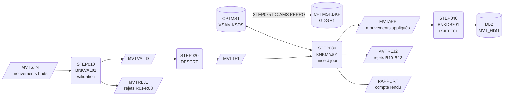

# Batch bancaire COBOL — mainframe z/OS

Chaîne batch complète de traitement des mouvements bancaires quotidiens, écrite pour z/OS : **COBOL, JCL, VSAM KSDS, DFSORT, IDCAMS, GDG et DB2**.

La chaîne valide les mouvements du jour, les trie, met à jour le fichier maître des comptes en contrôlant le découvert autorisé, produit un compte rendu avec totaux de contrôle, puis charge l'historique dans une table DB2.

Les programmes batch hors DB2 sont aussi compilés et testés automatiquement avec GnuCOBOL (GitHub Actions), à partir des mêmes sources que sur z/OS.

---

## Schéma de la chaîne



## Contenu du dépôt

| Élément | Rôle |
|---|---|
| `src/cobol/BNKINI01.cbl` | Chargement initial du KSDS des comptes |
| `src/cobol/BNKVAL01.cbl` | Validation des mouvements (8 contrôles, dont dates et années bissextiles) |
| `src/cobol/BNKMAJ01.cbl` | Mise à jour du KSDS par rupture sur le compte, contrôle du découvert, compte rendu |
| `src/cobol/BNKDB201.cbl` | Chargement de l'historique DB2 (INSERT, COMMIT périodique, gestion SQLCODE) |
| `src/copybook/` | Descriptions d'enregistrements (`CPYMVT`, `CPYCPT`, `CPYREJ`) et DCLGEN DB2 (`DCLMVTH`) |
| `jcl/DEFKSDS.jcl` | IDCAMS : définition du KSDS et de la GDG, puis chargement initial |
| `jcl/COMPBAT.jcl` | Compilation des programmes batch (procédure IGYWCL) |
| `jcl/COMPDB2.jcl` | Compilation avec le coprocesseur DB2 et BIND package/plan |
| `jcl/BNKCHAIN.jcl` | La chaîne batch complète (6 steps) |
| `jcl/RESTORE.jcl` | Restauration du KSDS depuis la dernière sauvegarde |
| `sql/CRTABLE.sql` | DDL de la table `MVT_HIST` et requêtes de vérification |
| `data/` | Jeu de test : 8 comptes, 25 mouvements dont 14 cas d'erreur |
| `tests/run_local.sh` | Exécution locale de la chaîne et comparaison aux résultats attendus |

## Règles de gestion

**Validation (BNKVAL01)** — le premier contrôle en erreur détermine le code rejet :

| Code | Contrôle |
|---|---|
| R01 | Référence du mouvement absente |
| R02 | Numéro de compte non numérique |
| R03 | Type différent de `D` (débit) ou `C` (crédit) |
| R04 | Montant non numérique |
| R05 | Montant nul |
| R06 | Date non numérique |
| R07 | Date invalide (mois, nombre de jours, 29 février hors année bissextile) |
| R08 | Date postérieure à la date de traitement |

**Mise à jour (BNKMAJ01)** :

| Code | Contrôle |
|---|---|
| R10 | Compte inexistant dans le KSDS |
| R11 | Compte bloqué |
| R12 | Débit qui ferait dépasser le découvert autorisé |

## Choix techniques

- **Traitement par rupture sur le numéro de compte** : une seule lecture directe du KSDS et un seul `REWRITE` par compte, quel que soit le nombre de mouvements. Le solde est calculé en mémoire.
- **Contrôle de séquence** : `BNKMAJ01` vérifie que le fichier est bien trié et s'arrête en RC=16 sinon, plutôt que de produire une mise à jour fausse.
- **Tri métier** : à date égale, les crédits passent avant les débits (`24,1,CH,A`). Dans le jeu de test, le compte `10000000003` reçoit un virement et un prélèvement le même jour : grâce à ce tri, le prélèvement passe au lieu d'être rejeté pour découvert.
- **Totaux de contrôle** : le compte rendu vérifie que mouvements lus = appliqués + rejetés. En cas d'écart, RC=16.
- **Codes retour normalisés** : 0 = OK, 4 = rejets ou avertissements, 12 = erreur SQL, 16 = erreur fichier. Les steps suivants sont conditionnés par `COND=` et par `IF/THEN/ENDIF`.
- **File status testé après chaque opération d'E/S**, y compris le `97` VSAM (ouverture après VERIFY implicite).
- **Reprise** : sauvegarde du KSDS dans une GDG avant mise à jour (`STEP025`) et JCL de restauration. Le chargement DB2 est relançable sans doublons : un `SQLCODE -803` (clé en double) signifie que le mouvement est déjà chargé, il est compté et ignoré.
- **DB2** : COMMIT tous les 100 mouvements, diagnostic des erreurs avec `DSNTIAR`, `ROLLBACK` puis arrêt RC=12.
- **Montants** en `COMP-3` dans le fichier maître, compte rendu édité au format français (`DECIMAL-POINT IS COMMA`).

## Résultat sur le jeu de test

```
 BNKMAJ01 - COMPTE RENDU DE MISE A JOUR DES COMPTES   DATE : 01/11/2026
 -------------------------------------------------------------------------------------
 COMPTE              SOLDE AVANT   APP   REJ         SOLDE APRES  ETAT
 -------------------------------------------------------------------------------------
 10000000001            1.500,00     3     0             -245,50  MIS A JOUR
 10000000002              250,00     1     1            1.450,00  MIS A JOUR
 10000000003             -100,00     2     0              100,00  MIS A JOUR
 10000000004           12.000,00     2     0           10.430,01  MIS A JOUR
 10000000005              800,00     0     1              800,00  COMPTE BLOQUE
 10000000006                0,00     1     1             -150,00  MIS A JOUR
 10000000007            3.200,50     1     0            4.200,00  MIS A JOUR
 10000000008               45,90     1     0               35,90  MIS A JOUR
 99999999999                         0     2                      COMPTE INEXISTANT
 -------------------------------------------------------------------------------------
 MOUVEMENTS LUS                 :      16
 MOUVEMENTS APPLIQUES           :      11
 MOUVEMENTS REJETES             :       5
 COMPTES MIS A JOUR             :       7
 TOTAL DES CREDITS              :           2.899,50
 TOTAL DES DEBITS               :           3.975,49
 CONTROLE LUS = APP + REJ       : OK
```

Sur les 25 mouvements en entrée, 9 sont rejetés à la validation (R01 à R08) et 5 à la mise à jour (R10, R11, R12). Les fichiers attendus sont dans `tests/expected/`.

## Exécution locale (GnuCOBOL)

```bash
sudo apt-get install gnucobol     # ou : brew install gnucobol
bash tests/run_local.sh
```

Le script compile les programmes, convertit les données au format mainframe (enregistrements fixes `RECFM=FB`, sans fin de ligne), exécute les steps dans l'ordre du JCL et compare les sorties aux résultats attendus. Les cartes DD sont simulées par des variables d'environnement (`DD_MVTIN`, `DD_CPTMST`…), ce qui permet d'utiliser les sources z/OS sans aucune modification. Le tri DFSORT est émulé avec `sort`. Le step DB2 n'est exécutable que sur z/OS.

## Déploiement sur z/OS (Zowe CLI)

Remplace `Z99999` par ton identifiant.

```bash
# Bibliothèques et fichiers (PDS et séquentiels FB 80 par défaut)
zowe zos-files create data-set-partitioned "Z99999.BANK.COBOL"
zowe zos-files create data-set-partitioned "Z99999.BANK.CPY"
zowe zos-files create data-set-partitioned "Z99999.DBRMLIB"
zowe zos-files create data-set-sequential  "Z99999.BANK.SEED.COMPTES"
zowe zos-files create data-set-sequential  "Z99999.BANK.MVTS.IN"

# Sources, copybooks et données
zowe zos-files upload dir-to-pds "src/cobol"    "Z99999.BANK.COBOL"
zowe zos-files upload dir-to-pds "src/copybook" "Z99999.BANK.CPY"
zowe zos-files upload file-to-data-set "data/comptes.txt"    "Z99999.BANK.SEED.COMPTES"
zowe zos-files upload file-to-data-set "data/mouvements.txt" "Z99999.BANK.MVTS.IN"

# Compilation, initialisation, exécution
zowe zos-jobs submit local-file "jcl/COMPBAT.jcl" --view-all-spool-content
zowe zos-jobs submit local-file "jcl/COMPDB2.jcl" --view-all-spool-content
zowe zos-jobs submit local-file "jcl/DEFKSDS.jcl" --view-all-spool-content
zowe zos-jobs submit local-file "jcl/BNKCHAIN.jcl" --view-all-spool-content
```

Avant le premier lancement :

1. Créer la table avec `sql/CRTABLE.sql` (SPUFI, DSNTEP2 ou l'extension DB2 de VS Code).
2. Dans `COMPDB2.jcl` et `BNKCHAIN.jcl`, adapter `DB2HLQ` (bibliothèque `SDSNLOAD`) et `SSID` (sous-système DB2) à ton site. Sur IBM Z Xplore, reprends les valeurs des JCL fournis dans les challenges DB2.
3. La date de traitement est passée en carte `SYSIN` (`20261101`) aux steps 010 et 030 ; en production, elle viendrait de l'ordonnanceur.

## Pistes d'évolution

- Transaction **CICS** de consultation d'un compte (écran BMS + lecture du KSDS).
- Exposition de cette consultation en **API REST** avec z/OS Connect.
- Ordonnancement de la chaîne (Control-M ou IBM Workload Scheduler).
- Extraction des rejets vers un fichier CSV pour les équipes métier.

## Environnement

Développé avec VS Code (IBM Z Open Editor), Zowe CLI et l'environnement IBM Z Xplore ; testé en continu avec GnuCOBOL 3.
