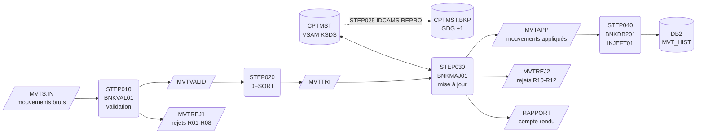
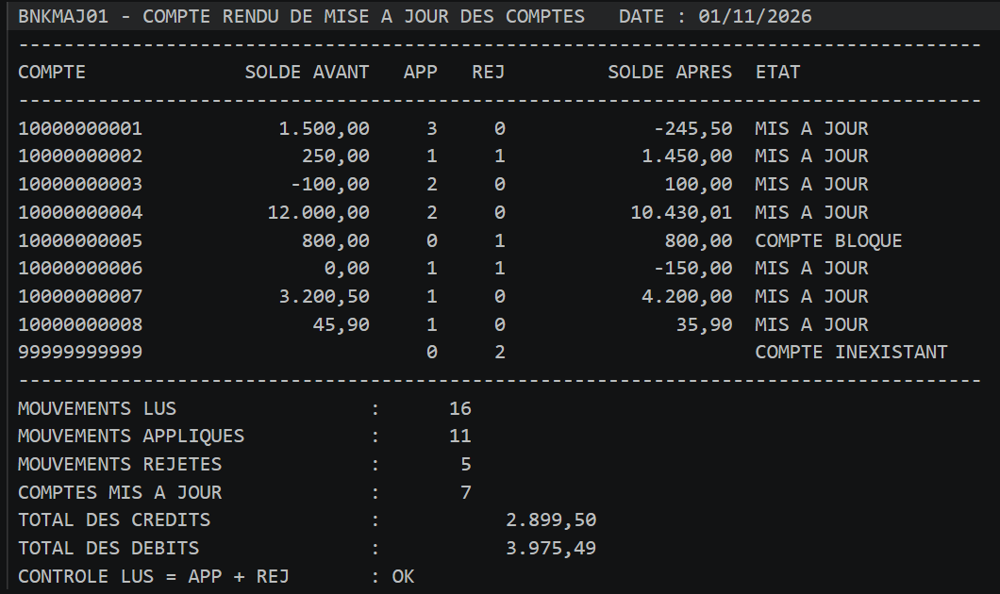
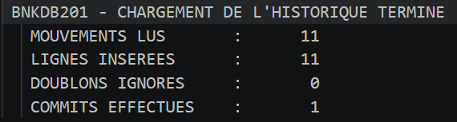
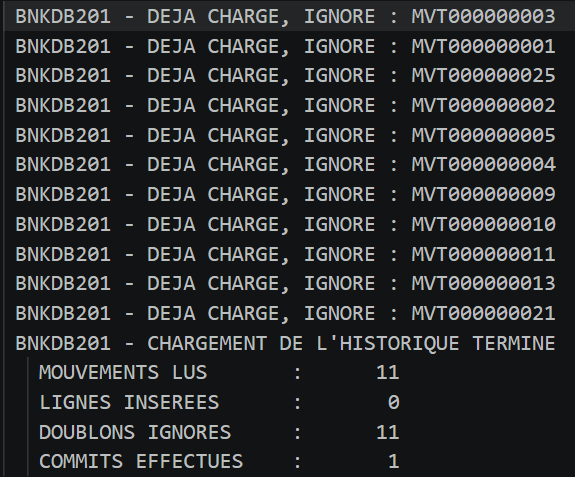
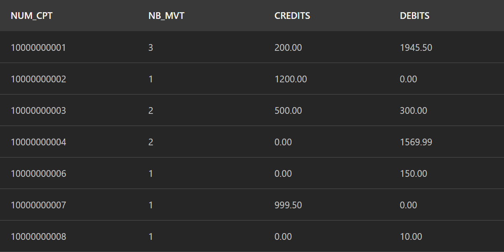

# Batch bancaire COBOL — mainframe z/OS

Chaîne batch complète de traitement des mouvements bancaires quotidiens, écrite pour z/OS : **COBOL, JCL, VSAM KSDS, DFSORT, IDCAMS, GDG et DB2**.

La chaîne valide les mouvements du jour, les trie, met à jour le fichier maître des comptes en contrôlant le découvert autorisé, produit un compte rendu avec totaux de contrôle, puis charge l'historique dans une table DB2.

> ✅ **Testée de bout en bout sur un vrai mainframe** (IBM Z Xplore : z/OS 3.1, Enterprise COBOL, Db2 for z/OS) — voir [Exécution sur z/OS](#exécution-sur-zos-ibm-z-xplore).
> ✅ **Testée en continu** à chaque push avec GnuCOBOL (GitHub Actions), à partir des mêmes sources.

---

## Schéma de la chaîne



## Exécution sur z/OS (IBM Z Xplore)

| Job / step | Programme | RC obtenu | Résultat |
|---|---|---|---|
| COMPBAT | Compilation batch | 04 | Avertissements du compilateur uniquement |
| DEFKSDS | IDCAMS + BNKINI01 | 00 | KSDS et GDG définis, 8 comptes chargés |
| BNKCHAIN STEP010 | BNKVAL01 | 04 | 25 lus, 16 valides, 9 rejetés |
| BNKCHAIN STEP020 | DFSORT | 00 | Mouvements triés |
| BNKCHAIN STEP025 | IDCAMS REPRO | 00 | Sauvegarde du KSDS dans la GDG |
| BNKCHAIN STEP030 | BNKMAJ01 | 04 | 11 appliqués, 5 rejetés, 7 comptes mis à jour |
| COMPDB2 | Coprocesseur SQL + BIND | 04 | Plan lié avec succès |
| LOADDB2 (1er passage) | BNKDB201 | 00 | 11 lignes insérées |
| LOADDB2 (relance) | BNKDB201 | 04 | 11 doublons ignorés, aucune ligne en double |

RC=4 sur les steps de traitement est attendu : le jeu de test contient volontairement des mouvements en erreur.

**Compte rendu de mise à jour (STEP030, sortie RAPPORT)**



**Chargement DB2, puis relance du même job : aucun doublon (SQLCODE -803 géré)**





**Contrôle dans DB2 : les totaux de la table correspondent au compte rendu** (2 899,50 de crédits et 3 975,49 de débits)



Le compte rendu obtenu sur z/OS est identique, ligne pour ligne, à celui produit par GnuCOBOL dans GitHub Actions (`tests/expected/rapport.txt`).

## Contenu du dépôt

| Élément | Rôle |
|---|---|
| `src/cobol/BNKINI01.cbl` | Chargement initial du KSDS des comptes |
| `src/cobol/BNKVAL01.cbl` | Validation des mouvements (8 contrôles, dont dates et années bissextiles) |
| `src/cobol/BNKMAJ01.cbl` | Mise à jour du KSDS par rupture sur le compte, contrôle du découvert, compte rendu |
| `src/cobol/BNKDB201.cbl` | Chargement de l'historique DB2 (INSERT, COMMIT périodique, gestion SQLCODE) |
| `src/copybook/` | Descriptions d'enregistrements (`CPYMVT`, `CPYCPT`, `CPYREJ`) et DCLGEN DB2 (`DCLMVTH`) |
| `jcl/ALLOC.jcl` | Allocation des bibliothèques et fichiers d'entrée (IEFBR14) |
| `jcl/DEFKSDS.jcl` | IDCAMS : définition de la GDG et du KSDS, puis chargement initial (relançable) |
| `jcl/COMPBAT.jcl` | Compilation des programmes batch (procédure IGYWCL) |
| `jcl/COMPDB2.jcl` | Compilation avec le coprocesseur DB2, édition de liens et BIND |
| `jcl/BNKCHAIN.jcl` | La chaîne batch complète (6 steps) |
| `jcl/LOADDB2.jcl` | Relance seule du chargement DB2 après incident |
| `jcl/RESTORE.jcl` | Restauration du KSDS depuis la dernière sauvegarde |
| `sql/CRTABLE.sql` | DDL de la table `MVT_HIST` et requêtes de contrôle |
| `data/` | Jeu de test : 8 comptes, 25 mouvements dont 14 cas d'erreur |
| `tests/` | Exécution locale de la chaîne et résultats attendus |
| `docs/` | Captures de l'exécution sur z/OS |

## Règles de gestion

**Validation (BNKVAL01)** — le premier contrôle en erreur détermine le code rejet :

| Code | Contrôle |
|---|---|
| R01 | Référence du mouvement absente |
| R02 | Numéro de compte non numérique |
| R03 | Type différent de `D` (débit) ou `C` (crédit) |
| R04 | Montant non numérique |
| R05 | Montant nul |
| R06 | Date non numérique |
| R07 | Date invalide (mois, nombre de jours, 29 février hors année bissextile) |
| R08 | Date postérieure à la date de traitement |

**Mise à jour (BNKMAJ01)** :

| Code | Contrôle |
|---|---|
| R10 | Compte inexistant dans le KSDS |
| R11 | Compte bloqué |
| R12 | Débit qui ferait dépasser le découvert autorisé |

## Choix techniques

- **Traitement par rupture sur le numéro de compte** : une seule lecture directe du KSDS et un seul `REWRITE` par compte, quel que soit le nombre de mouvements. Le solde est calculé en mémoire.
- **Contrôle de séquence** : `BNKMAJ01` vérifie que le fichier est bien trié et s'arrête en RC=16 sinon, plutôt que de produire une mise à jour fausse.
- **Tri métier** : à date égale, les crédits passent avant les débits (`24,1,CH,A`). Dans le jeu de test, le compte `10000000003` reçoit un virement et un prélèvement le même jour : grâce à ce tri, le prélèvement passe au lieu d'être rejeté pour découvert.
- **Totaux de contrôle** : le compte rendu vérifie que mouvements lus = appliqués + rejetés. En cas d'écart, RC=16.
- **Codes retour normalisés** : 0 = OK, 4 = rejets ou avertissements, 12 = erreur SQL, 16 = erreur fichier. Les steps suivants sont conditionnés par `COND=` et par `IF/THEN/ENDIF`.
- **File status testé après chaque opération d'E/S**, y compris le `97` VSAM (ouverture après VERIFY implicite).
- **`BLOCK CONTAINS 0 RECORDS`** sur les fichiers séquentiels : la taille de bloc est déterminée par le système.
- **Reprise** : sauvegarde du KSDS dans une GDG avant mise à jour (`STEP025`) et JCL de restauration. Le chargement DB2 est relançable sans doublons : un `SQLCODE -803` (clé en double) signifie que le mouvement est déjà chargé, il est compté et ignoré. Le job `LOADDB2.jcl` relance ce chargement seul.
- **DB2** : COMMIT tous les 100 mouvements, diagnostic des erreurs avec `DSNTIAR`, `ROLLBACK` puis arrêt RC=12.
- **Montants** en `COMP-3` dans le fichier maître, compte rendu édité au format français (`DECIMAL-POINT IS COMMA`).

## Problèmes rencontrés sur z/OS et solutions

Le passage de GnuCOBOL au vrai mainframe a demandé plusieurs adaptations, toutes diagnostiquées à partir des messages système :

| Symptôme | Cause | Solution |
|---|---|---|
| Création de fichier refusée par Zowe CLI : *SMS or ACS services returned an error* | Les attributs envoyés par défaut ne respectent pas les règles de stockage du site | `zowe zos-files create data-set ... --like <modèle> --record-length 80`, ou allocation par JCL (`ALLOC.jcl`) |
| `ABEND S913`, message `ICH408I ... INSUFFICIENT ACCESS AUTHORITY` | Accès RACF refusé à une bibliothèque DB2 qui n'était pas celle du site | Utilisation de la bibliothèque `SDSNLOAD` et du sous-système DB2 du site |
| `SQLCODE -551` au `CREATE TABLE` | Création de table interdite hors de la base de données de l'utilisateur | Ajout de `IN DATABASE <ID>` |
| `IEW2456E SYMBOL CEESTART UNRESOLVED` (et autres `CEE*`, `IGZ*`) à l'édition de liens | Bibliothèque Language Environment absente du `SYSLIB` | `LKED.SYSLIB` déclaré explicitement : `CEE.SCEELKED` puis `SDSNLOAD` |
| `DSN SYSTEM(&SSID)` transmis tel quel, `COMMAND BIND NOT FOUND` | Un symbole défini par `SET` n'est pas substitué dans les cartes in-stream | Ajout de `// EXPORT SYMLIST=*` |
| `DSNT235I BIND AUTHORIZATION ERROR ... PRIVILEGE = BINDADD` | Création de package interdite au compte étudiant | DBRM lié directement dans le plan (`BIND PLAN ... MEMBER(BNKDB201)`). En entreprise : `BIND PACKAGE` dans une collection, puis `BIND PLAN ... PKLIST` |

## Déploiement sur z/OS (Zowe CLI)

Remplace `Z99999` par ton identifiant.

**1. Fichiers.** Les bibliothèques de sources sont créées sur le modèle d'une bibliothèque FB 80 existante, les fichiers de données sur le modèle d'un fichier séquentiel existant (ou avec `jcl/ALLOC.jcl`). `Z99999.LOAD` et `Z99999.DBRMLIB` doivent exister.

```bash
zowe zos-files create data-set "Z99999.BANK.COBOL" --like "Z99999.CBL"
zowe zos-files create data-set "Z99999.BANK.CPY"   --like "Z99999.CBL"
zowe zos-files create data-set "Z99999.BANK.SEED.COMPTES" --like "<FICHIER SEQUENTIEL FB>" --record-length 80
zowe zos-files create data-set "Z99999.BANK.MVTS.IN"      --like "<FICHIER SEQUENTIEL FB>" --record-length 80
```

**2. Sources et données.**

```bash
zowe zos-files upload dir-to-pds "src/cobol"    "Z99999.BANK.COBOL"
zowe zos-files upload dir-to-pds "src/copybook" "Z99999.BANK.CPY"
zowe zos-files upload file-to-data-set "data/comptes.txt"    "Z99999.BANK.SEED.COMPTES"
zowe zos-files upload file-to-data-set "data/mouvements.txt" "Z99999.BANK.MVTS.IN"
```

**3. Table DB2.** Exécuter `sql/CRTABLE.sql` (extension Db2 for z/OS de VS Code, SPUFI ou DSNTEP2), après avoir remplacé `Z99999` par ton identifiant dans la clause `IN DATABASE`.

**4. Compilation, initialisation, exécution.**

```bash
zowe zos-jobs submit local-file "jcl/COMPBAT.jcl"  --wait-for-output
zowe zos-jobs submit local-file "jcl/COMPDB2.jcl"  --wait-for-output
zowe zos-jobs submit local-file "jcl/DEFKSDS.jcl"  --wait-for-output
zowe zos-jobs submit local-file "jcl/BNKCHAIN.jcl" --wait-for-output
```

À adapter à ton site : `DB2HLQ` (préfixe de `SDSNLOAD`) et `SSID` (sous-système DB2) dans `COMPDB2.jcl`, `BNKCHAIN.jcl` et `LOADDB2.jcl`. Les valeurs fournies (`DSND10`, `DBDG`) sont celles d'IBM Z Xplore. La date de traitement est passée en carte `SYSIN` (`20261101`) aux steps 010 et 030 ; en production, elle viendrait de l'ordonnanceur.

Pour retrouver les mêmes résultats lors d'une nouvelle exécution, relancer `DEFKSDS.jcl` avant `BNKCHAIN.jcl` (sinon les mouvements s'appliquent à des soldes déjà mis à jour).

## Exécution locale (GnuCOBOL)

```bash
sudo apt-get install gnucobol     # ou : brew install gnucobol
bash tests/run_local.sh
```

Le script compile les programmes, convertit les données au format mainframe (enregistrements fixes `RECFM=FB`, sans fin de ligne), exécute les steps dans l'ordre du JCL et compare les sorties aux résultats attendus (`tests/expected/`). Les cartes DD sont simulées par des variables d'environnement (`DD_MVTIN`, `DD_CPTMST`…), ce qui permet d'utiliser les sources z/OS sans aucune modification. Le tri DFSORT est émulé avec `sort`. Le step DB2 n'est exécutable que sur z/OS.

## Pistes d'évolution

- Transaction **CICS** de consultation d'un compte (écran BMS + lecture du KSDS).
- Exposition de cette consultation en **API REST** avec z/OS Connect.
- Ordonnancement de la chaîne (Control-M ou IBM Workload Scheduler).
- Extraction des rejets vers un fichier CSV pour les équipes métier.

## Environnement

Développé avec VS Code (IBM Z Open Editor, Zowe Explorer, Db2 for z/OS Developer Extension) et Zowe CLI ; exécuté sur IBM Z Xplore ; testé en continu avec GnuCOBOL 3.
